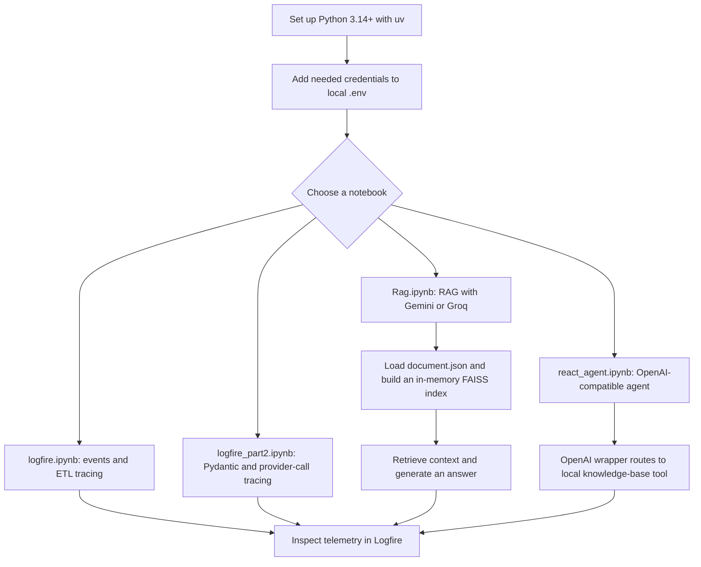

# Pydantic Logfire Experiments

A Python learning workspace for exploring [Pydantic Logfire](https://logfire.pydantic.dev/), LangChain, model-provider APIs, retrieval-augmented generation (RAG), and tool-using agents. The work is currently notebook-based; `main.py` is only a greeting script, not an application server.

## Workspace flow



## Requirements and setup

- Python 3.14 or newer, as specified by `.python-version` and `pyproject.toml`.
- [uv](https://docs.astral.sh/uv/) for environment and dependency management.
- API credentials for the providers used by the notebook you plan to run, and a Logfire project for remote telemetry.

From the workspace root:

```sh
uv sync
cp -n .env_git_sample .env
```

Edit `.env` and populate only the keys required for your chosen notebook. The sample provides these variable names:

```dotenv
Tavily_API=
Groq_API=
Open_AI_API=
Logfire_API=
Gemini_API=
```

The notebooks load environment values with `python-dotenv`. `.env` is ignored by Git; never commit or share real credentials. If a key was exposed, revoke it with its provider and create a replacement. In VS Code, select the workspace `.venv` kernel and run notebook setup cells in order.

## Notebooks and data

### `react_agent.ipynb`

Builds a tool-using LangChain agent with `create_agent`, an OpenAI-compatible model configured through `ChatOpenAI`, and a local knowledge-base search tool. The sample questions include LLM guardrails, gateways, and a general-knowledge question. The system prompt asks the model to use local search for covered topics and answer unrelated questions directly. `run_agent()` wraps calls in a Logfire span and reports whether a tool message occurred.

The notebook currently uses the OpenAI-compatible Gemini endpoint in the `ChatOpenAI` setup and also defines an OpenAI model. Since Gemini function-calling through the OpenAI-compatible endpoint has raised a missing `thought_signature` error, the agent is configured with `openai_llm`; this notebook's latest successful run shows the general-knowledge query answered without using the local-search tool. The Gemini wrapper remains defined for separate experiments.

### `Rag.ipynb`

Loads `document.json`, converts its topic/content records into LangChain `Document` objects, embeds them with `GoogleGenerativeAIEmbeddings`, and builds an in-memory FAISS index. The retriever is configured to return two documents. `rag()` uses a Groq chat model and `rag2()` uses a Gemini model; both create a Logfire span and record retrieval/output events. The returned answer must be printed or displayed separately, for example `print(rag("What is RAG?"))`.

The FAISS index is rebuilt in memory when its setup cell runs; the notebook does not persist the index to disk. Provider model IDs and access can change, so check the provider's current model list if a call fails.

### `logfire.ipynb`

Demonstrates loading environment variables, configuring Logfire, writing `logfire.info()` events, and grouping ETL-style steps under a parent span. It includes an optional system-metrics instrumentation example.

### `logfire_part2.ipynb`

Contains Pydantic request/response models, manual spans, provider calls through LangChain's `ChatOpenAI` wrapper, and tracing examples. It is an experiment: run setup cells in order and verify model identifiers and credentials before calling providers.

### `document.json`

Sample knowledge-base content for RAG, fine-tuning, evaluations, observability, prompting, and LLM gateways. Both `Rag.ipynb` and `react_agent.ipynb` read it from the workspace's current working directory.

## Run the starter script

```sh
uv run main.py
```

This prints `Hello from pydantic-logfire!`; it does not launch a server or run an LLM workflow.

## Project files

- `react_agent.ipynb` — OpenAI-compatible LangChain agent, local search tool, and Logfire tracing.
- `Rag.ipynb` — RAG ingestion, retrieval, model calls, and tracing.
- `logfire.ipynb` — Basic Logfire events and ETL spans.
- `logfire_part2.ipynb` — Pydantic and multi-provider tracing experiments.
- `document.json` — Sample RAG knowledge-base records.
- `main.py` — Minimal Python entry point.
- `pyproject.toml` and `uv.lock` — Project metadata, dependency declarations, and resolved versions.
- `requirements.txt` — Alternative pip requirements list.
- `.env_git_sample` — Empty local credentials template; copy it to `.env`.

