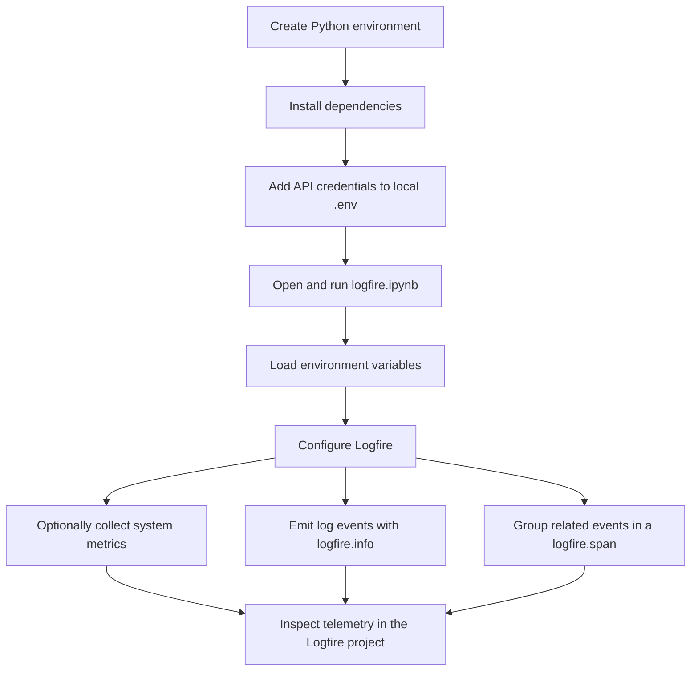

# Pydantic Logfire

A small Python workspace for experimenting with [Pydantic Logfire](https://logfire.pydantic.dev/). The Jupyter notebook demonstrates configuring Logfire, emitting log events, and creating a traced ETL-style span. The current `main.py` is only a starter script that prints a greeting; the LangChain, Streamlit, and vector-search packages in the dependencies are not yet wired into an application.

## Project flow



## Requirements

- Python 3.14 or newer (as declared in `pyproject.toml`).
- [uv](https://docs.astral.sh/uv/) for environment and dependency management.
- API credentials for the integrations you intend to use. The notebook checks for `Gemini_API`, `Logfire_API`, `Open_AI_API`, `Groq_API`, and `Tavily_API`.

## Setup

1. From the project directory, install the project and its dependencies:

   ```sh
   uv sync
   ```

2. Create a local `.env` file in the project root and add only the credentials you need. Use the variable names listed above, for example:

   ```dotenv
   Logfire_API=your_logfire_token
   Gemini_API=your_gemini_key
   Open_AI_API=your_openai_key
   Groq_API=your_groq_key
   Tavily_API=your_tavily_key
   ```

   `.env` is ignored by Git. Do not commit real credentials or paste them into source files, notebooks, or this README.

3. In VS Code, open `logfire.ipynb`, select the project's `.venv` Python kernel, and run the notebook cells from top to bottom. The notebook calls `load_dotenv()` to read the local environment variables.

The notebook includes an optional `logfire.instrument_system_metrics()` example. The project declares the `logfire[system-metrics]` extra; if that call reports a missing instrumentation package, run `uv sync` using the current `pyproject.toml` and restart the notebook kernel.

## Run the starter script

```sh
uv run main.py
```

At present, this prints `Hello from pydantic-logfire!`; it does not start a web app or an AI workflow.

## Workspace files

- `logfire.ipynb` — Logfire setup, credential presence checks, example log events, optional system metrics, and a traced ETL-style example.
- `main.py` — Minimal Python entry point.
- `pyproject.toml` and `uv.lock` — Project metadata, dependency declarations, and locked versions.
- `requirements.txt` — Alternative pip-style dependency list.

