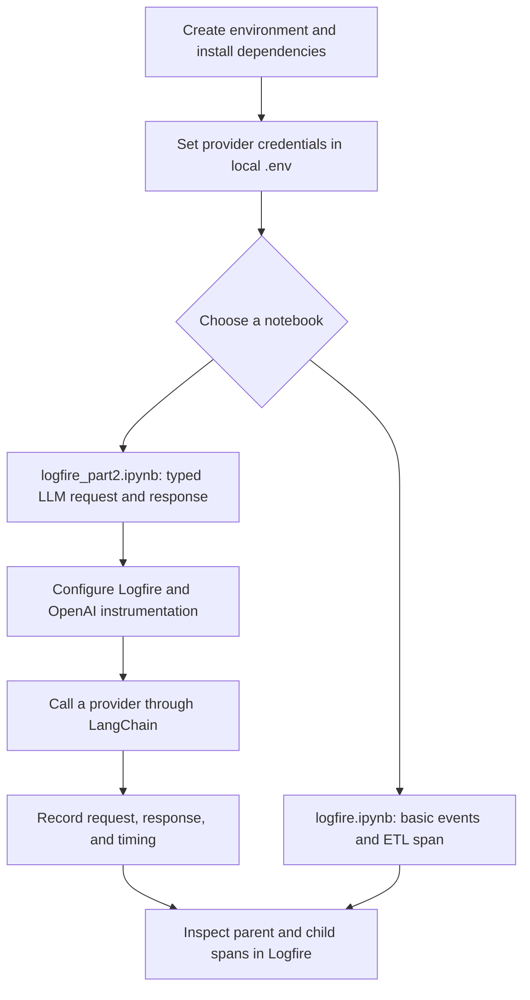

# Pydantic Logfire Experiments

A Python learning workspace for instrumenting application and LLM activity with [Pydantic Logfire](https://logfire.pydantic.dev/). The notebooks contain progressively more detailed examples: basic events and spans, Pydantic request/response models, provider calls through LangChain, and nested tracing around calls to Google Gemini, Groq, and OpenAI-compatible APIs.

This is an experimental notebook project, not a finished application. `main.py` currently only prints a greeting; the Streamlit, LangGraph, and retrieval/vector-search dependencies are not yet connected to an app.

## Notebook flow



The multi-provider example in `logfire_part2.ipynb` wraps calls in a parent span and a child span per provider. The calls are made one after another, even though the parent span's name says “Simultanously”.

## Requirements

- Python 3.14 or newer (from `pyproject.toml` and `.python-version`).
- [uv](https://docs.astral.sh/uv/) for dependency and environment management.
- API credentials for whichever providers you plan to call. The notebook reads `Gemini_API`, `Logfire_API`, `Open_AI_API`, `Groq_API`, and `Tavily_API` from the environment. Not every notebook example needs every key.
- A Logfire project/account to receive telemetry.

## Setup

1. Install the project dependencies from the workspace root:

   ```sh
   uv sync
   ```

2. Copy `.env_git_sample` to `.env` and fill in only the credentials needed for your tests:

   ```dotenv
   Gemini_API=your_gemini_key
   Logfire_API=your_logfire_token
   Open_AI_API=your_openai_key
   Groq_API=your_groq_key
   Tavily_API=your_tavily_key
   ```

   `.env` is ignored by Git. Never commit or share real keys. If a key has been exposed, revoke it with its provider and replace it.

3. Open a notebook in VS Code and select the project's `.venv` kernel (Python 3.14+). Run the required setup cells first so imports, environment variables, model objects, and `logfire.configure()` are initialized.

## Notebooks

### `logfire.ipynb`

Demonstrates loading `.env`, configuring Logfire, emitting `logfire.info()` events, and creating an ETL-style parent span with nested step events. It also includes optional system-metrics instrumentation.

### `logfire_part2.ipynb`

Demonstrates Pydantic models for sample LLM request/response data, manual spans, automatic OpenAI-client instrumentation, and provider calls using LangChain's `ChatOpenAI` wrapper with provider-compatible endpoints. It also includes a Groq model-list example and a traced multi-provider example with latency and response-length attributes.

Model identifiers and provider access can change. If a request returns `model_not_found` or an access error, check the provider's current model list and use an ID enabled for your account. Keep the notebook's configured model ID and any mock `model_used` labels consistent.

**Notebook execution note:** the OpenAI model setup cell is followed by a cell that deletes `openai_llm`, while the later multi-provider example uses it. After restarting the kernel, skip that deletion cell or rerun the model setup before running the multi-provider example.

## Run the starter script

```sh
uv run main.py
```

This currently prints `Hello from pydantic-logfire!`; it does not launch a server or make an LLM call.

## Project files

- `logfire.ipynb` — Basic Logfire events and nested tracing.
- `logfire_part2.ipynb` — Pydantic, LangChain/provider, and multi-provider tracing experiments.
- `main.py` — Minimal Python entry point.
- `pyproject.toml` and `uv.lock` — Project metadata, dependencies, and resolved versions.
- `requirements.txt` — Alternative pip requirements list.
- `.env_git_sample` — Empty template for local provider credentials; copy to `.env` before adding keys.

