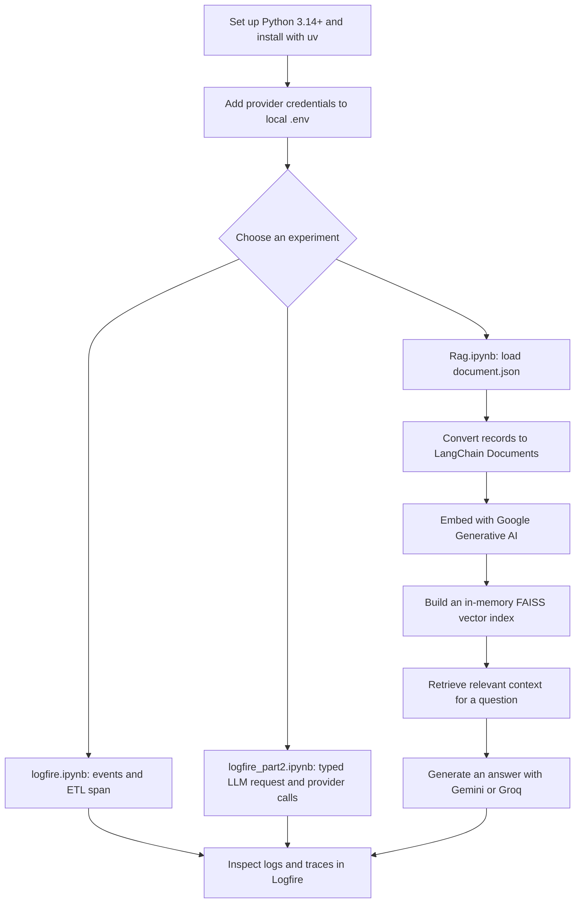

# Pydantic Logfire Experiments

A Python learning workspace for experimenting with [Pydantic Logfire](https://logfire.pydantic.dev/), LangChain, LLM provider APIs, and retrieval-augmented generation (RAG). The main examples live in Jupyter notebooks; `main.py` remains a minimal starter script, not a production app.

## Workspace flow



## Requirements and setup

- Python 3.14 or newer, as specified by `.python-version` and `pyproject.toml`.
- [uv](https://docs.astral.sh/uv/) for environment and dependency management.
- Provider credentials for the integrations you want to try, plus a Logfire project for remote telemetry.

From the workspace root:

```sh
uv sync
cp -n .env_git_sample .env
```

Edit `.env` and fill in only the keys you need. The sample defines these variable names:

```dotenv
Tavily_API=
Groq_API=
Open_AI_API=
Logfire_API=
Gemini_API=
```

`.env` is ignored by Git. Never commit or share real credentials. If any key has been exposed, revoke it with its provider and replace it. In VS Code, open a notebook, select the workspace `.venv` kernel, and run setup cells before the cells that use the configured model, retriever, or Logfire.

## Notebooks and data

### `Rag.ipynb`

Loads `document.json`, converts its topic/content records into LangChain `Document` objects, embeds them with `GoogleGenerativeAIEmbeddings`, and builds an in-memory FAISS index. The retriever is configured to return two documents per query. The `rag()` function sends retrieved context to a Groq chat model; `rag2()` uses Gemini. Both functions create a Logfire parent span and log retrieved topics and the generated output. Print or display the returned value when calling a function, for example `print(rag("What is RAG?"))`.

The notebook contains separate model setup experiments, including an OpenAI-compatible Groq endpoint. Running cells that reassign a model variable changes which provider/model later calls use. Run the setup cell for the provider you intend to test before defining/calling the corresponding RAG function. Provider model IDs and access can change; check the provider's current model list if a call returns a model-not-found or server error.

The FAISS index is constructed in memory each time the embedding/index cell runs; it is not loaded from or saved to disk by the current notebook.

### `logfire.ipynb`

Demonstrates loading environment variables, configuring Logfire, writing `logfire.info()` events, and grouping example ETL steps in a parent span. It also contains an optional system-metrics instrumentation example.

### `logfire_part2.ipynb`

Contains Pydantic request/response models, manually created spans, OpenAI-compatible provider calls, and examples of tracing model activity and timing. Treat it as an experiment: execute setup cells in order, verify model IDs and credentials, and be aware that model setup/deletion cells can affect later examples.

### `document.json`

Small example knowledge base with records on RAG, fine-tuning, evaluations, observability, prompting, and LLM gateways. `Rag.ipynb` reads this file from the current working directory.

## Run the starter script

```sh
uv run main.py
```

This prints `Hello from pydantic-logfire!`; it does not launch a server or run an LLM workflow.

## Project files

- `Rag.ipynb` — RAG ingestion, retrieval, model calls, and Logfire tracing experiments.
- `logfire.ipynb` — Basic Logfire events and spans.
- `logfire_part2.ipynb` — Pydantic and multi-provider tracing experiments.
- `document.json` — Sample RAG knowledge-base records.
- `main.py` — Minimal Python entry point.
- `pyproject.toml` and `uv.lock` — Project metadata, dependency declarations, and resolved versions.
- `requirements.txt` — Alternative pip requirements list.
- `.env_git_sample` — Empty local credentials template; copy it to `.env`.

